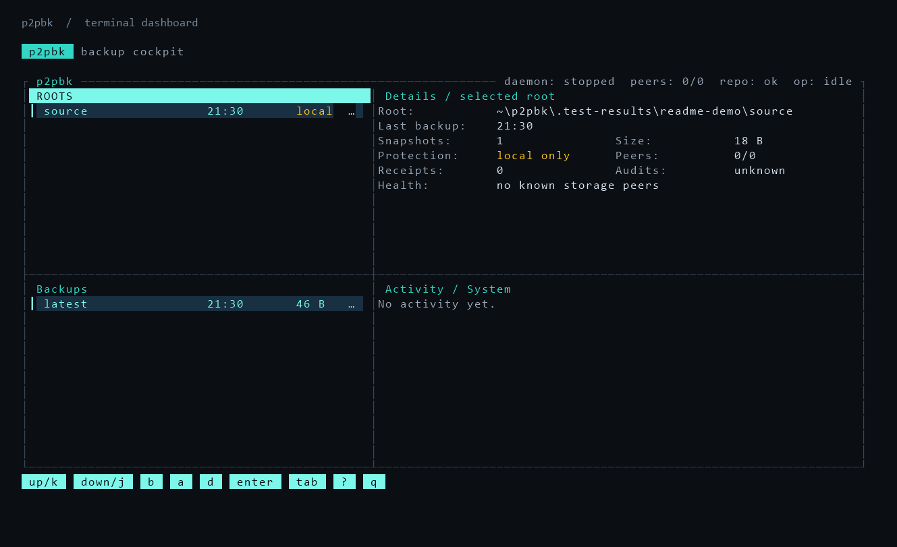

# p2pbk

**Share some disk space. Back up your files across other computers.**

p2pbk is an experimental peer-to-peer backup tool built around a simple idea:
share a little space on your computer for other people's backups, and let other
computers help look after yours. Find peers on your local network or over the
internet with the help of discovery infrastructure.

Your files are encrypted and split into redundant pieces before they are sent.
Sharing space is the goal; p2pbk does not currently enforce a one-for-one
exchange or guarantee that peers will be available.

> **A little heads-up:** p2pbk is still experimental. Please keep another
> backup of anything important while we work on it.



*The main terminal dashboard, rendered from a local demo node. This example
does not demonstrate distribution across peers.*

## Try it

You'll need Go 1.21 or newer. Clone the repository, open a terminal in the
project folder, and start the dashboard:

```sh
go run -buildvcs=false ./cmd/p2pbk tui
```

Press `i` to get started, `?` to see the controls, and `q` when you're done.

## How it works

1. [Kopia](https://github.com/kopia/kopia) creates encrypted, deduplicated
   snapshots, so unchanged data does not need to be stored again.
2. For peer storage, p2pbk divides encrypted blobs into data and parity shards
   and sends them to storage peers over [libp2p](https://libp2p.io/).
3. To restore, it finds the shards, reconstructs the encrypted blobs, and lets
   Kopia decrypt the snapshot into your chosen folder.

The default 6+3 policy can reconstruct a blob from any six of its nine shards.
That tolerates up to three missing shards per blob, provided the remaining
shards are available. It does not guarantee survival of three lost computers:
that depends on where the shards were placed.

## Using peers

Peer-backed backups need reachable storage nodes that are ready to accept data.
Each storage node must approve a peer before accepting its new shards. Set up
discovery or bootstrap addresses before creating a remote repository: its
storage mode is fixed when first opened, so a local repository won't
automatically become a peer-backed one later.

For remote backups, export and refresh an encrypted recovery checkpoint after
backups, and keep it on another device along with a way to recover your
password. The checkpoint contains the metadata needed to find your shards; it
cannot recover shards that no peer still has. See the [recovery workflow and
storage contracts](docs/TESTING.md).

## Project status

The CLI, terminal dashboard, local and distributed storage, snapshots, restore,
and recovery paths are implemented. The project is still being qualified;
automatic repair and rebalancing, broader network coverage, and extended soak
tests remain work in progress. See the [implementation status](docs/MVP_IMPLEMENTATION_STATUS.md)
and [testing guide](docs/TESTING.md) for the evidence and limits.

To run the normal Go suite:

```sh
go test ./... -count=1 -timeout=5m
```

Docker integration tests and other qualification checks are documented in the
[testing guide](docs/TESTING.md).

## Built with open source

p2pbk stands on the work of many open-source projects, especially:

- [Kopia](https://github.com/kopia/kopia) for encrypted, deduplicated backups.
- [libp2p](https://github.com/libp2p/go-libp2p) and its [Kademlia DHT](https://github.com/libp2p/go-libp2p-kad-dht) for peer networking and discovery.
- [Reed-Solomon](https://github.com/klauspost/reedsolomon) for splitting data into recoverable shards.
- [Bubble Tea](https://github.com/charmbracelet/bubbletea), [Bubbles](https://github.com/charmbracelet/bubbles), and [Lip Gloss](https://github.com/charmbracelet/lipgloss) for the terminal interface.
- [age](https://github.com/FiloSottile/age) for local identity encryption, and [SQLite](https://sqlite.org/) for local state.

Thank you to their maintainers and contributors. p2pbk is licensed under
[Apache 2.0](LICENSE).
