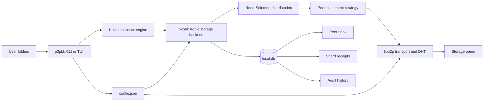
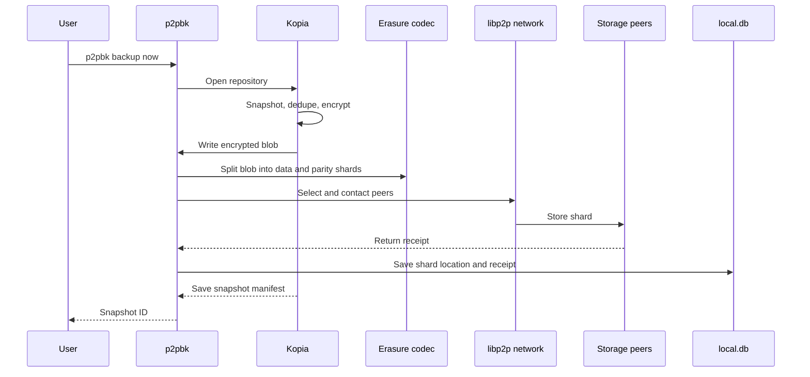
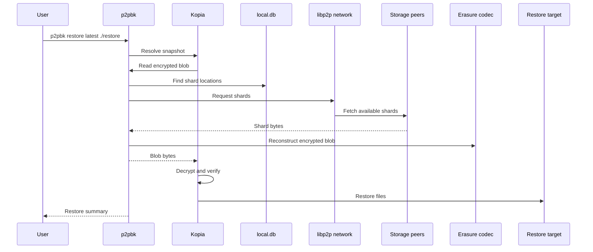
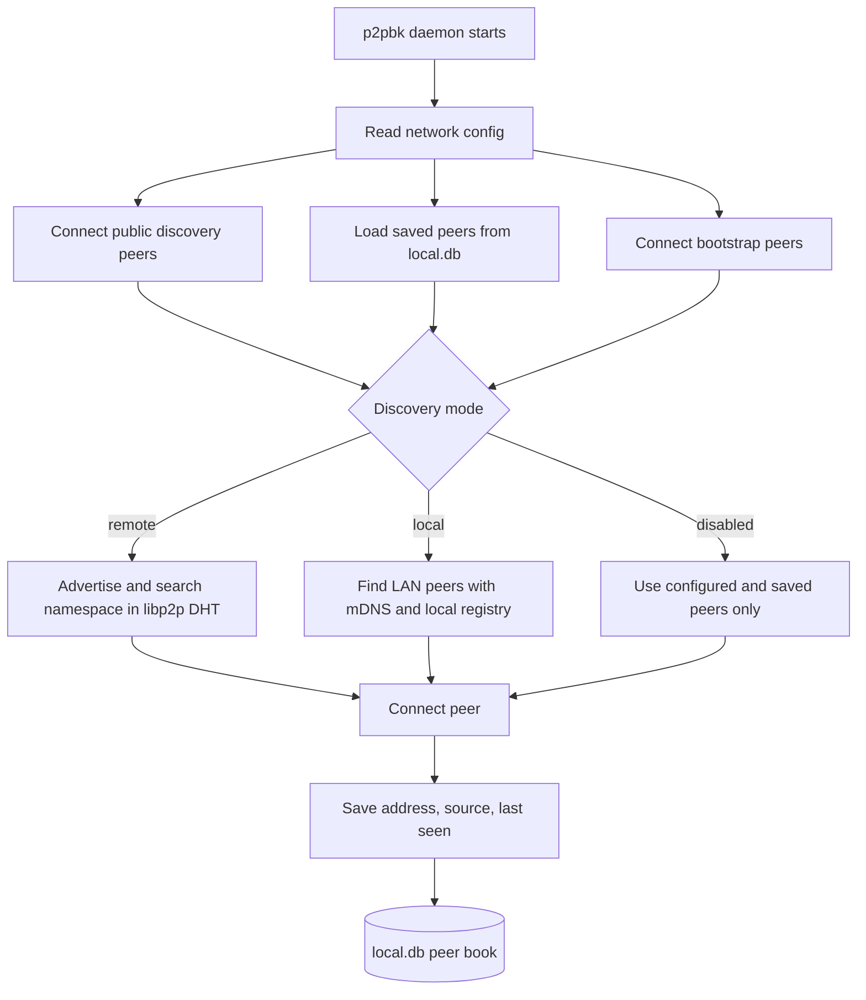

# p2pbk

p2pbk is an experimental peer-to-peer backup system. It takes the backup model
people already expect from a serious tool, encrypted snapshots, deduplication,
incremental uploads, and point-in-time restores, and connects it to a cooperative
storage network instead of a single cloud bucket.

The project uses Kopia for the hard backup work and libp2p for the network. p2pbk
sits between them: it exposes a Kopia-compatible storage backend, splits encrypted
backup blobs into redundant shards, places those shards on peers, records where
they went, and rebuilds the data during restore.

This repository is still experimental. Treat it as a prototype for development,
testing, and design validation before relying on it as the only copy of important
data.

## Product idea

p2pbk is built around a simple exchange: every node can protect its own files and
offer some local disk space to help store other nodes' encrypted shards. A backup
does not need every storage peer to be online forever. With the default 6+3
erasure policy, p2pbk stores each blob as six data shards plus three parity
shards, so the original blob can be reconstructed even if some shards are
unavailable.

Kopia remains responsible for snapshot semantics. That means backups are logical
full snapshots, while storage is incremental and deduplicated: unchanged content
is not uploaded again. p2pbk focuses on distributed placement, peer discovery,
local accounting, receipts, audits, and restore-time shard retrieval.

## Quick start

Build or install the `p2pbk` binary, then initialize a node with the directory you
want to protect. The repository password is required for Kopia and identity
access; pass it directly for local testing or provide it through
`P2PBK_REPOSITORY_PASSWORD`.

```bash
p2pbk init --dir ~/Documents --max-space 10GB --offer-space 20GB --schedule daily --passphrase "change-me"
```

Run an on-demand backup of every configured root:

```bash
P2PBK_REPOSITORY_PASSWORD="change-me" p2pbk backup now
```

Check local state, repository status, protected roots, and known peers:

```bash
p2pbk status
p2pbk status --long
```

List known peers and their local trust history:

```bash
p2pbk peers
```

Inspect snapshots:

```bash
P2PBK_REPOSITORY_PASSWORD="change-me" p2pbk snapshot list
P2PBK_REPOSITORY_PASSWORD="change-me" p2pbk snapshot show latest
```

Restore the latest snapshot into a target directory:

```bash
P2PBK_REPOSITORY_PASSWORD="change-me" p2pbk restore latest ./restore
```

Run the background service explicitly when you want scheduled backups, peer
storage, discovery, and audits to stay active:

```bash
P2PBK_REPOSITORY_PASSWORD="change-me" p2pbk --config ~/.p2pbk/config.json daemon
```

`p2pbk init` starts the daemon by default unless `--start=false` is provided.

## High-level architecture



## How it works

### Backups

When a backup starts, p2pbk opens or initializes a Kopia repository using the
configured p2pbk storage backend. Kopia walks the source directory, chunks and
deduplicates content, encrypts repository data with the repository password, and
writes snapshot metadata plus content blobs through the storage interface.

p2pbk receives those encrypted blobs as storage writes. For distributed storage,
it splits each blob into data and parity shards, chooses peers, sends one shard
assignment at a time over libp2p, and records shard locations locally. Storage
peers return receipts so the owner can later prove what was accepted and audit
whether it is still retrievable.



### Restores

Restore begins with a Kopia snapshot reference, either a manifest ID or
`latest`. Kopia asks the p2pbk backend for the encrypted blobs needed to rebuild
the snapshot. p2pbk looks up shard locations, fetches available shards from
peers, reconstructs the original encrypted blob when enough shards are present,
and hands it back to Kopia. Kopia then decrypts and writes files to the restore
target.



### Peer discovery

p2pbk can discover peers in three modes. `remote` is the default and uses public
discovery peers, saved peer addresses, and the libp2p DHT namespace. `local`
uses LAN discovery through mDNS plus a small local registry fallback. `disabled`
turns discovery off, leaving only explicitly configured or previously saved
peers.

The daemon keeps the peer book in `local.db`. It connects to configured bootstrap
peers, saves connected peers, records failures, and updates peer trust history
from storage, receipt, and audit results.



## Configuration model

p2pbk stores user-tunable settings in `config.json`, normally under
`~/.p2pbk/config.json`. Environment variables can override settings through the
`P2PBK_` prefix, and the repository password is read from
`P2PBK_REPOSITORY_PASSWORD` by normal backup, restore, snapshot, daemon, and
audit commands.

The main config groups are:

- `node`: local data directory, identity file, and optional display name.
- `storage`: local shard store, cache directory, cache size, and how much space
  this node offers to other peers.
- `network`: listen addresses, bootstrap peers, public discovery peers,
  discovery mode, protocol ID, DHT namespace, and peer target settings.
- `backup`: protected roots, maximum protected bytes, schedule, retention,
  incremental policy, and data/parity shard counts.
- `trust`: identity passphrase support, challenge interval, reputation window,
  and maximum challenge size.

By default, p2pbk listens on TCP and QUIC libp2p addresses, uses remote
discovery, targets at least three peers, protects up to 10 GB, offers 10 GB to
the network, and uses a 6+3 erasure policy.

## Storage, safety, and security

Storage peers are not trusted with plaintext backup data. Kopia encrypts
repository content before p2pbk distributes it, and p2pbk stores shards of those
encrypted blobs. Peers do not receive the repository password, do not run Kopia
restore logic for the owner, and do not need enough context to interpret the
backup.

Receipts and audits are the accountability layer. When a peer accepts a shard,
p2pbk records a receipt in the owner's local database. Later audits challenge
peers for stored shard bytes and verify them by hash. Failures are recorded in
local trust history and can influence peer selection as the project evolves.

Erasure coding improves availability but is not magic. If too many shards for a
blob disappear, that blob cannot be reconstructed. For now, keep independent
backups of important data while testing p2pbk.

## Networking

p2pbk uses libp2p host identities and multiaddrs. The daemon registers storage
and responder services on the local libp2p host, connects to configured peers,
participates in DHT-backed discovery when enabled, and stores known addresses in
`local.db` so future runs can reconnect faster.

Public discovery peers are infrastructure peers used to help discovery and
connectivity. Bootstrap peers are storage-network peers the node should try to
connect to directly. LAN mode is useful for local test clusters because it avoids
depending on remote discovery infrastructure.

## Main open-source building blocks

- [Kopia](https://github.com/kopia/kopia): encrypted repositories,
  deduplicated snapshots, manifests, restore logic, and maintenance primitives.
- [libp2p](https://github.com/libp2p/go-libp2p): peer identity, transports,
  streams, NAT traversal support, and peer connections.
- [go-libp2p-kad-dht](https://github.com/libp2p/go-libp2p-kad-dht):
  Kademlia-style DHT support used by remote discovery.
- [Reed-Solomon](https://github.com/klauspost/reedsolomon): data/parity shard
  coding for distributed storage redundancy.
- [age](https://github.com/FiloSottile/age): local identity encryption support.
- [SQLite](https://sqlite.org/): durable local state for peers, receipts,
  settings, trust history, and audits.
- [Cobra](https://github.com/spf13/cobra): command-line structure.
- [Viper](https://github.com/spf13/viper): config loading, defaults, and
  environment overrides.
- [Bubble Tea](https://github.com/charmbracelet/bubbletea),
  [Bubbles](https://github.com/charmbracelet/bubbles), and
  [Lip Gloss](https://github.com/charmbracelet/lipgloss): terminal UI
  foundation.

## Repository layout

- `cmd/p2pbk/`: the user-facing CLI, daemon, bootstrap mode, and Kopia command
  wiring.
- `internal/kopiaengine/`: Kopia repository integration and the custom storage
  provider.
- `internal/backend/p2p/`: distributed blob backend, shard dispatch, placement,
  erasure coding, and location tracking.
- `internal/network/`: libp2p host setup, DHT support, discovery, and wire
  protocol routing.
- `internal/peer/`: local peer database, blob server, quota enforcement, and
  responder services.
- `internal/trust/`: identity, receipts, reputation, and challenge primitives.
- `internal/config/`: config schema, defaults, validation, and path handling.
- `internal/tui/`: terminal UI forms and directory picker.
- `deploy/` and `test/integration/`: container and end-to-end test surfaces.

## Development

See the [reliable MVP implementation plan](docs/MVP_IMPLEMENTATION_PLAN.md) for
ordered milestones, reusable AI-agent prompts, whole-product acceptance criteria,
and release gates, including CLI, TUI, services, recovery, and both binaries.
The [reliability review and test plan](docs/RELIABILITY_TEST_PLAN.md) records the
historical baseline and original proposed tests.
See [Testing and recovery contracts](docs/TESTING.md) for the implemented P0 suite,
CI checks, recovery bundles, and compatibility boundaries.

Build the local binary on Windows:

```powershell
powershell -ExecutionPolicy Bypass -File .\scripts\build-release.ps1
.\dist\p2pbk.exe version
```

Run the Go test suite:

```powershell
go test ./...
```

Docker integration tests are opt-in using the `docker` build tag. The normal
suite runs without Docker. Make sure Docker is running for the container suite:

```powershell
go test -tags=docker ./test/integration -run TestDocker -v -count=1 -timeout=20m
```

To print container logs even when the test passes:

```powershell
$env:P2PBK_DOCKER_E2E_LOGS="1"
go test -tags=docker ./test/integration -run TestDocker -v -count=1 -timeout=20m
```
