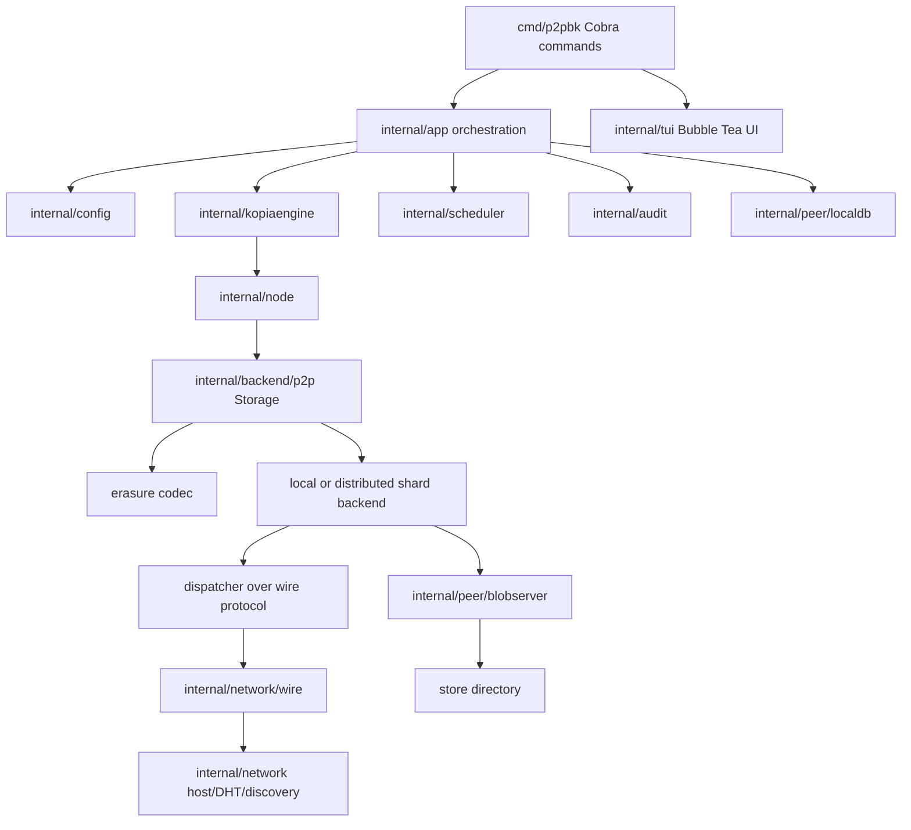
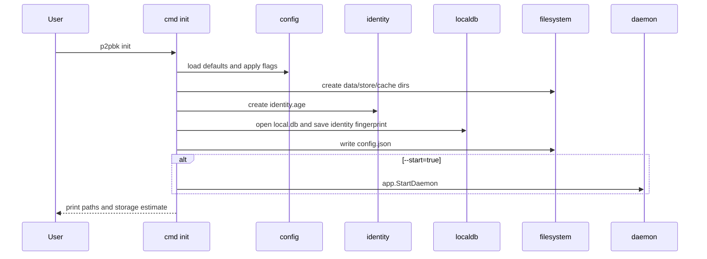
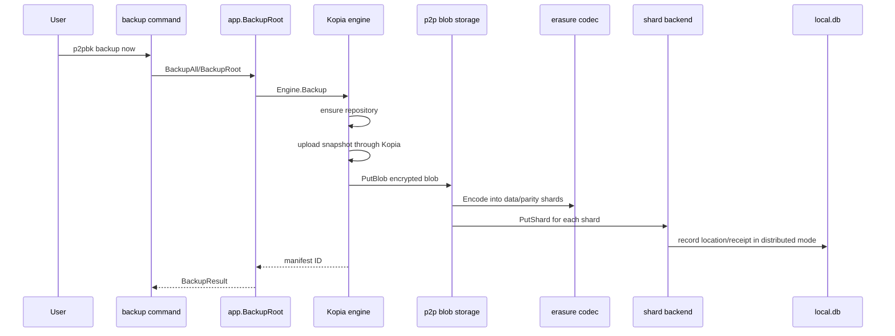
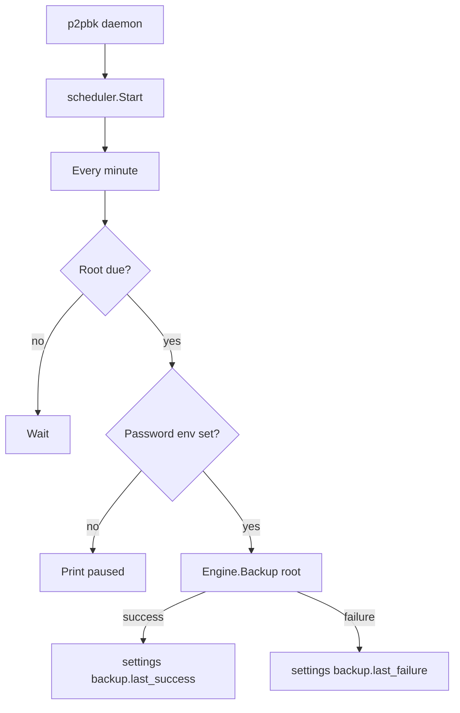
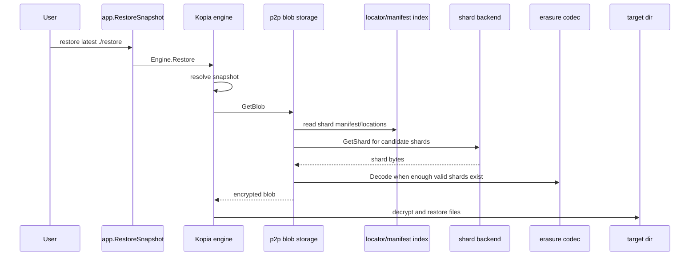
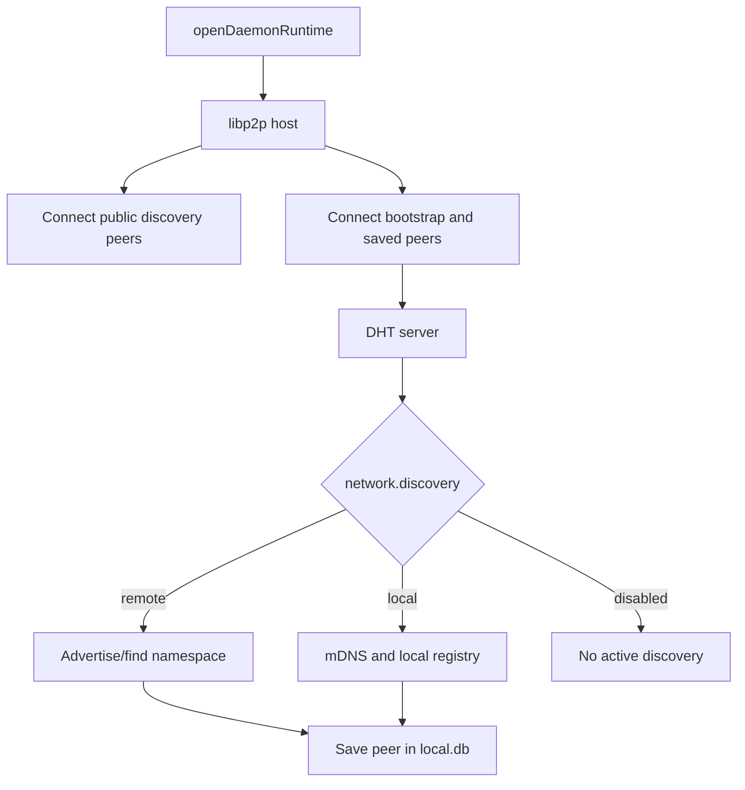
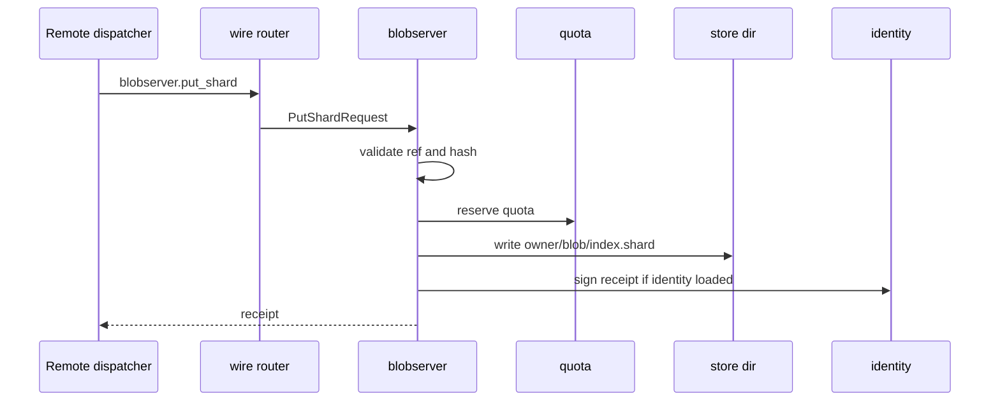
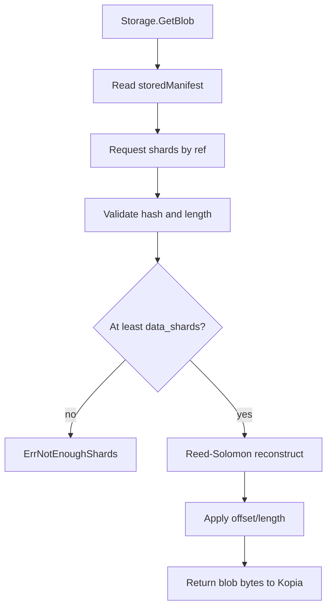
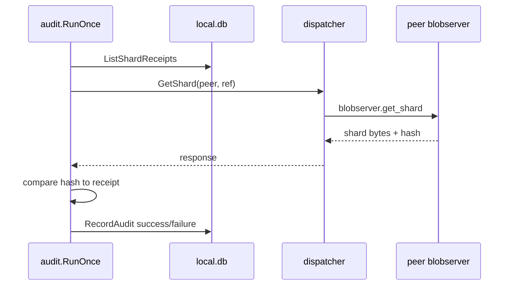

# p2pbk Codebase Guide

This guide is for a developer who wants to understand and own this
repo. It explains how the CLI commands move through the code, where state lives,
how Kopia and libp2p are connected, and which parts are product behavior versus
implementation scaffolding.

Read it as a map. You do not need to memorize every package. The goal is to know
where to look, what each layer owns, and how to trace a bug or feature from the
command line down to storage and networking.

## 1. Product mental model

p2pbk is an experimental peer-to-peer backup system. The product idea is:

- Kopia handles encrypted, deduplicated snapshots and restores.
- p2pbk provides a Kopia-compatible blob storage backend.
- That backend splits encrypted Kopia blobs into erasure-coded shards.
- Shards can be stored locally or sent to libp2p storage peers.
- Local state records config, identity, known peers, shard receipts, audits, and
  scheduler history.

The user mental model is small:

1. Initialize a node.
2. Add folders to protect.
3. Run backups manually or through the daemon scheduler.
4. Discover/connect peers.
5. Restore snapshots when needed.
6. Audit peers that are supposed to hold shards.

The implementation model has more layers:



### What is implemented

- CLI command surface for init, config, add, backup, restore, repo, snapshot,
  status, peers, audit, reset, daemon, bootstrap, and version.
- TUI dashboard for status, folder management, backups, restore, config editing,
  daemon start/stop, audit, and reset.
- Kopia-backed backup/restore using a custom p2pbk storage provider.
- Local shard storage and distributed shard storage.
- Reed-Solomon erasure coding with per-shard hashes.
- libp2p host creation, JSON wire protocol, DHT support, local and remote
  discovery services.
- Peer blob server with quota and optional signed receipts.
- SQLite local database for peers, receipts, audit history, and settings.
- Scheduler for due backups.
- Hash-based audits of stored shard receipts.
- Docker e2e tests for backup/restore and degraded restore.

### What is experimental or partially wired

- Distributed storage is real, but the system is still prototype quality.
- `local.db` has an `owned_blobs` table, but the main live path uses
  `manifests.json` plus receipts rather than a rich owned-blob model.
- Challenge/response primitives exist in `internal/trust/challenges` and
  `internal/peer/responder`, but the active audit path mostly fetches shards and
  verifies hashes through `internal/audit`.
- CLI `init` has its own implementation in `cmd/p2pbk/cmd_init.go`; the TUI
  uses `internal/app.Initialize`. They are similar, but this is a consolidation
  target.
- `cmd/p2pdiscovery` exists as a separate public discovery binary, while
  `p2pbk bootstrap` provides a hidden built-in bootstrap/discovery mode.

## 2. Repository map

### Top-level directories

| Path | Purpose | Start here |
| --- | --- | --- |
| `cmd/p2pbk` | Main product CLI and hidden daemon/bootstrap commands. | `root.go` |
| `cmd/p2pdiscovery` | Separate public discovery node binary. | `main.go` |
| `internal/app` | Application orchestration used by CLI and TUI. | `operations.go`, `init.go` |
| `internal/config` | Config schema, defaults, validation, path resolution. | `config.go`, `applydefaults.go`, `paths.go` |
| `internal/kopiaengine` | Kopia repository integration and p2pbk storage provider. | `engine.go`, `provider.go` |
| `internal/node` | Chooses local vs distributed storage and wires distributed storage. | `blob_storage.go`, `storage.go` |
| `internal/backend/p2p` | Kopia blob storage implementation over shards. | `storage.go` |
| `internal/network` | libp2p host, DHT, discovery, JSON wire protocol. | `host/host.go`, `wire/wire.go` |
| `internal/peer` | Storage peer services, local DB, quota, challenge responder. | `blobserver/blobserver.go`, `localdb/localdb.go` |
| `internal/trust` | Identity, receipts, challenges, in-memory reputation tracker. | `identity/identity.go` |
| `internal/audit` | Audits recorded shard receipts by fetching shards from peers. | `audit.go` |
| `internal/scheduler` | Daemon backup scheduler. | `scheduler.go` |
| `internal/tui` | Bubble Tea terminal UI. | `app.go`, `forms.go` |
| `internal/secrets` | Repository password environment helper. | `password.go` |
| `test/integration` | In-process and Docker integration tests. | `e2e_test.go`, `docker_*_test.go` |
| `deploy/docker` | Dockerfiles and compose example. | `Dockerfile`, `compose.yaml` |
| `docs` | Human-facing docs. | `DEPLOYMENT.md`, this file |

### Important packages

| Package | Responsibility | Called by | Owns data |
| --- | --- | --- | --- |
| `cmd/p2pbk` | Parses commands, flags, config path, and dispatches work. | User executable. | No durable state directly except CLI init/reset helpers write files. |
| `internal/app` | Product use cases: backup, restore, init, config save, status, audit, daemon process. | CLI and TUI. | Writes config, daemon pid/log, scheduler settings through localdb. |
| `internal/config` | Defines `Config`, defaults, env/config loading, validation, path normalization. | Almost every layer. | No state; describes state locations. |
| `internal/kopiaengine` | Wraps Kopia repository operations and registers p2pbk storage. | App backup/restore/repo/status. | Kopia repository config under data dir. |
| `internal/node` | Opens local or distributed blob storage based on config and saved peers. | Kopia provider. | Opens localdb and libp2p host for distributed storage. |
| `internal/backend/p2p` | Implements Kopia `blob.Storage` by encoding blobs into shards. | `internal/node`. | `manifests.json` blob-to-shard manifest index. |
| `internal/backend/p2p/erasure` | Reed-Solomon encode/decode and shard hash checks. | p2p storage. | No durable state. |
| `internal/backend/p2p/placement` | Peer assignment strategy. | Distributed backend. | No durable state. |
| `internal/backend/p2p/dispatcher` | Sends shard RPCs to peers. | Distributed backend and audit. | No durable state. |
| `internal/backend/p2p/locator` | Maps blob IDs to peer shard locations. | Distributed backend. | DHT values or persistent locator DB in tests/optional path. |
| `internal/network/host` | Creates libp2p hosts and parses multiaddrs. | Daemon, bootstrap, node storage, audit, tests. | libp2p in-memory host state. |
| `internal/network/wire` | JSON request/response protocol over libp2p streams. | Dispatcher, blobserver, responder. | No durable state. |
| `internal/network/dht` | Kademlia DHT wrapper and routing discovery. | Daemon, bootstrap, distributed storage. | DHT records in network. |
| `internal/network/discovery` | Connect configured/saved peers, local mDNS/file discovery, remote DHT discovery. | Daemon, node storage, audit. | Peer records through localdb. |
| `internal/peer/blobserver` | Stores, retrieves, deletes shard files; validates hashes; issues receipts. | Local storage and daemon wire service. | Shard files under store dir. |
| `internal/peer/localdb` | SQLite state store. | Init, daemon, discovery, status, audit, distributed backend. | `local.db`. |
| `internal/peer/quota` | In-memory quota accounting per owner. | Blobserver in daemon. | No durable state. |
| `internal/peer/responder` | Challenge responder over wire protocol. | Daemon. | In-memory reputation tracker plus possible localdb use. |
| `internal/trust/identity` | Encrypted Ed25519 identity file using age. | Init, daemon, distributed locator/receipts. | `identity.age`. |
| `internal/trust/receipts` | Signed receipt format. | Blobserver and localdb. | Receipt payload stored in localdb. |
| `internal/trust/challenges` | Challenge/proof primitives. | Responder tests and responder. | No durable state. |
| `internal/trust/reputation` | In-memory rolling challenge score tracker. | Responder. | No durable state. |
| `internal/audit` | Fetches receipt shards and checks hashes; records audit history. | CLI, TUI, daemon. | `audit_history`, peer stats. |
| `internal/scheduler` | Runs due backups from daemon. | Daemon. | `settings` keys for last success/failure. |
| `internal/tui` | Interactive UI state machine. | `p2pbk tui`. | Writes through app layer. |

## 3. Command guide

All commands enter at `cmd/p2pbk/root.go`. `PersistentPreRunE` resolves
`--config`, tries the default `~/.p2pbk/config.json`, loads it into Viper, and
lets `init` proceed when the config does not exist yet.

### `p2pbk init`

Syntax:

```bash
p2pbk init --dir <path> --max-space 10GB --offer-space 20GB --schedule daily --passphrase <password>
```

Important flags:

- `--data-dir`
- `--dir`
- `--max-space`
- `--offer-space`
- `--schedule`
- `--retention`
- `--name`
- `--bootstrap-peer`
- `--public-discovery-peer`
- `--passphrase`
- `--start`

User behavior: creates a p2pbk node, config file, local store/cache dirs,
encrypted identity, local database, and optionally starts the daemon.

Code path:

- `cmd/p2pbk/cmd_init.go`
- `runInit`
- `config.Default`, `cfg.Paths`
- `identity.Create`
- `localdb.Open`, `PutSetting("identity_fingerprint")`
- `writeInitialConfig`
- `app.StartDaemon` when `--start=true`

State touched:

- `config.json`
- data dir
- `identity.age`
- `store/`
- `cache/`
- `local.db`
- `p2pbk.pid` and `p2pbk.log` if daemon starts

Common failures:

- Missing passphrase.
- Config already exists.
- Identity already exists.
- Invalid byte size.
- Cannot create directories.
- Daemon start failure.

Debug:

- Check the printed config path.
- Inspect `~/.p2pbk/config.json`.
- Check `~/.p2pbk/p2pbk.log` if daemon start was requested.
- Use `p2pbk status --long`.

Note: TUI initialization uses `internal/app.Initialize` from
`internal/tui/forms.go`, not the CLI's `runInit`.

### `p2pbk status`

Syntax:

```bash
p2pbk status
p2pbk status --long
```

User behavior: shows storage usage, data/cache/store dirs, protected roots,
repository state, backup history, and known peers.

Code path:

- `cmd/p2pbk/cmd_status.go`
- `app.CollectStatus`
- `cfg.Paths`
- `kopiaengine.Engine.RepositoryConnected`
- `engine.ListSnapshots` only when `CollectStatus` receives a password; the
  current CLI status command passes an empty password, while the TUI can pass the
  in-memory session password
- `localdb.ListPeerStats`, `ListShardReceipts`, `ListAuditHistory`
- scheduler last-success/last-failure setting keys

State touched:

- Reads config.
- Reads store/cache sizes.
- Reads Kopia repository config if present.
- Reads `local.db`.

Common failures:

- Invalid config paths.
- Repository initialized but password absent, so snapshots cannot be listed.
- Local DB unavailable or malformed.

Debug:

- Use `--long` to print peer addresses and failure counts.
- If snapshot details matter, use `p2pbk snapshot list` or the TUI after
  entering the password; CLI `status` currently reports repository presence but
  does not unlock the repository for snapshot listing.
- If localdb looks wrong, inspect schema from `internal/peer/localdb/localdb.go`.

### `p2pbk tui`

Syntax:

```bash
p2pbk tui
```

User behavior: opens a Bubble Tea dashboard with tabs for Dashboard, Folders,
Backups, and Settings.

Code path:

- `cmd/p2pbk/cmd_tui.go`
- `tui.Run`
- `internal/tui/app.go`
- `internal/tui/forms.go`
- app functions for status, backup, restore, init, config, audit, daemon

State touched:

- Same state as the app action invoked by the UI.
- Keeps password only in UI memory for the session.

Common failures:

- Missing config: starts in Settings tab.
- Missing password: asks for password before backup/restore.
- Repository not initialized: Settings init path is offered.

Debug:

- Reproduce the same action through CLI first.
- Follow `submitForm` in `forms.go` to see exactly which app function the form
  calls.
- TUI operation progress is driven by `BackupRootWithEvents` and
  `RestoreSnapshotWithEvents`.

### `p2pbk config`

Syntax:

```bash
p2pbk config
p2pbk config --get backup.schedule
p2pbk config --set backup.schedule --value daily
```

User behavior: prints a config summary, gets a key from Viper, or writes a
supported config field.

Code path:

- `cmd/p2pbk/cmd_config.go`
- `viper.Get` for `--get`
- `app.ApplyConfigSet`
- `app.SaveConfig`
- `app.SummarizeConfig`

State touched:

- Reads/writes `config.json`.

Common failures:

- Unsupported key.
- Missing `--value` with `--set`.
- Value fails config validation.

Debug:

- Check supported keys in `internal/app/config.go`.
- `--get` reads from Viper, so it reflects loaded config and env overrides.

### `p2pbk add <path>`

Syntax:

```bash
p2pbk add ~/Documents
```

User behavior: adds a protected root to `backup.roots`.

Code path:

- `cmd/p2pbk/cmd_add.go`
- `app.AddAsset`
- `cfg.Paths`
- `blobserver.New` sanity-checks store dir
- `erasure.New` sanity-checks shard policy
- `app.SaveConfig`

State touched:

- Writes `config.json`.
- May create/check store dir.

Common failures:

- Path does not exist.
- Invalid erasure shard config.
- Config path missing, so no file is saved.

Debug:

- Run `p2pbk config` after adding.
- Check `backup.roots` in config.

### `p2pbk backup now`

Syntax:

```bash
P2PBK_REPOSITORY_PASSWORD=<password> p2pbk backup now
```

User behavior: backs up all configured roots.

Code path:

- `cmd/p2pbk/cmd_backup.go`
- `app.BackupAll`
- `app.BackupRoot`
- `kopiaengine.Engine.Backup`
- `Engine.ensureRepository`
- `repo.Initialize`, `repo.Connect`
- `repo.NewWriter`, `snapshotfs.NewUploader`, `snapshot.SaveSnapshot`
- custom p2pbk storage provider through `kopiaengine.RegisterProvider`

State touched:

- Kopia repository config: `kopia.repository.config`.
- `manifests.json`.
- Shard files under local or remote peer stores.
- `local.db` receipts and peer stats in distributed mode.

Common failures:

- No configured roots.
- Missing password.
- Source missing or not a directory.
- Not enough connected peers for distributed mode.
- Wrong identity password for distributed storage.

Debug:

- Start with local-only mode: no bootstrap/saved peers.
- Run `p2pbk repo init` separately.
- Use `p2pbk status --long` to confirm peers.
- Look for `connected peers X below network.min_peers Y`.

### `p2pbk backup <source> <description>`

Syntax:

```bash
P2PBK_REPOSITORY_PASSWORD=<password> p2pbk backup /path/to/source "manual note"
```

User behavior: backs up one directory with a custom snapshot description.

Code path: same as `backup now`, except it calls `app.BackupRoot` directly for
the supplied source.

State touched: same as `backup now`.

Common failures:

- Source argument missing.
- Source is not one directory.
- Source does not exist.

Debug:

- This is a good path for debugging one root without changing config.

### `p2pbk restore <snapshot-id|latest> <target>`

Syntax:

```bash
P2PBK_REPOSITORY_PASSWORD=<password> p2pbk restore latest ./restore
```

User behavior: restores a Kopia snapshot into a target directory.

Code path:

- `cmd/p2pbk/cmd_restore.go`
- `app.RestoreSnapshot`
- `kopiaengine.Engine.Restore`
- `Engine.resolveSnapshot`
- `snapshotfs.EntryFromDirEntry`
- `restore.FilesystemOutput`
- `restore.Entry`
- p2pbk storage `GetBlob`

State touched:

- Reads Kopia repository config.
- Reads `manifests.json`.
- Fetches local/remote shards.
- Writes restore target files.

Common failures:

- Missing password.
- Repository not connected.
- Snapshot ID not found.
- Not enough shards to reconstruct a blob.
- Target path permission errors.

Debug:

- `p2pbk snapshot list`.
- `p2pbk snapshot show latest`.
- In distributed mode, confirm surviving peers in config/peer book.
- Look for erasure `not enough valid shards` errors.

### `p2pbk repo`

Subcommands:

```bash
p2pbk repo init
p2pbk repo connect
p2pbk repo status
p2pbk repo maintenance
```

User behavior:

- `init` and `connect` both call `app.EnsureRepository`.
- `status` prints Kopia connection info and snapshot count.
- `maintenance` prints Kopia maintenance schedule.

Code path:

- `cmd/p2pbk/cmd_repo.go`
- `app.EnsureRepository`
- `app.GetRepositoryStatus`
- `app.GetMaintenanceStatus`
- `kopiaengine.Engine`

State touched:

- Kopia repository config.
- p2pbk storage state.

Common failures:

- Missing config path.
- Missing password.
- Repository not initialized for status/maintenance.

Debug:

- Use `repo init` before backup to isolate repository creation from snapshot
  upload.
- Friendly CLI error differs slightly from app/TUI friendly error text.

### `p2pbk snapshot list`

Syntax:

```bash
P2PBK_REPOSITORY_PASSWORD=<password> p2pbk snapshot list
```

User behavior: lists Kopia snapshot manifest IDs and basic metadata.

Code path:

- `cmd/p2pbk/cmd_snapshot.go`
- `openExistingKopiaEngine`
- `engine.ListSnapshots`
- Kopia `snapshot.ListSnapshotManifests`

State touched:

- Reads Kopia repository config and p2pbk storage.

Common failures:

- Repository not initialized.
- Missing password.
- Storage backend cannot read needed blobs.

Debug:

- If this fails after backup, the issue is usually repository access or storage
  read path, not CLI formatting.

### `p2pbk snapshot show <snapshot-id|latest>`

Syntax:

```bash
P2PBK_REPOSITORY_PASSWORD=<password> p2pbk snapshot show latest
```

User behavior: prints details for one snapshot.

Code path:

- `cmd/p2pbk/cmd_snapshot.go`
- `engine.ShowSnapshot`
- `Engine.resolveSnapshot`

State touched:

- Reads Kopia manifests and storage blobs.

Common failures:

- Same as `snapshot list`.
- Unknown snapshot ID.

Debug:

- `latest` goes through code that scans all snapshots and chooses newest
  `StartTime`.

### `p2pbk peers`

Syntax:

```bash
p2pbk peers
```

User behavior: lists known peers, local score, status, stored shards, and audit
summary.

Code path:

- `cmd/p2pbk/cmd_peers.go`
- `cfg.Paths`
- `localdb.Open`
- `db.ListPeerStats`

State touched:

- Reads `local.db` peers, receipts, and audit-derived stats.

Common failures:

- Local DB open failure.
- Empty output when no peers are known.

Debug:

- Peer rows are persisted by discovery, distributed storage, and audits.
- Score/status logic is in `internal/peer/localdb/trust.go`.

### `p2pbk audit now`

Syntax:

```bash
p2pbk audit now --limit 25 --timeout 2s
```

User behavior: checks peers that previously returned shard receipts.

Code path:

- `cmd/p2pbk/cmd_audit.go`
- `app.RunAudit`
- `audit.RunOnce`
- `localdb.ListShardReceipts`
- `dispatcher.GetShard`
- `localdb.RecordAudit`

State touched:

- Reads shard receipts.
- Connects to configured/saved peers.
- Writes `audit_history`.
- Updates peer stats.

Common failures:

- No peer connectivity.
- Peer no longer has a shard.
- Shard hash mismatch.
- Invalid peer ID in receipt.

Debug:

- Use low `--limit` to inspect one/few receipts.
- Check `p2pbk peers` after audit.
- Remember this audit path validates hash by fetching shard bytes; it is not
  using the full challenge proof flow yet.

### `p2pbk reset`

Syntax:

```bash
p2pbk reset --yes
p2pbk reset --yes --delete-protected-data --confirm-delete-protected-data=DELETE-PROTECTED-DATA
```

User behavior: deletes local p2pbk state and config. Protected roots are kept
unless explicitly confirmed.

Code path:

- `cmd/p2pbk/cmd_reset.go`
- `runReset`
- local reset safety helpers

TUI reset uses:

- `internal/app.ResetLocalState`

State touched:

- Deletes data dir.
- Deletes external config path if outside data dir.
- Optionally deletes protected roots.

Common failures:

- Missing `--yes`.
- Refuses filesystem root, home dir, or cwd.
- Refuses non-empty storage while protected roots remain unless extra
  confirmation is supplied.

Debug:

- Tests in `cmd/p2pbk/cmd_reset_test.go` document the safety policy.
- Be careful: this command intentionally uses `os.RemoveAll`.

### Hidden `p2pbk daemon`

Syntax:

```bash
P2PBK_REPOSITORY_PASSWORD=<password> p2pbk --config /path/config.json daemon
```

User behavior: runs the background service: libp2p host, storage server, peer
discovery, scheduler, and periodic audits.

Code path:

- `cmd/p2pbk/cmd_daemon.go`
- `runDaemon`
- `openDaemonRuntime`
- `startDaemonNetworking`
- `registerDaemonServices`
- `startDaemonDiscovery`
- `startDaemonJobs`

State touched:

- Opens `local.db`.
- Serves shard files from store dir.
- Writes peer records from discovery.
- Writes scheduler history.
- Writes audit history.

Common failures:

- Cannot open localdb.
- Invalid public discovery peer multiaddr.
- DHT bootstrap failure.
- Missing password prevents signed receipts and scheduled backups.

Debug:

- Check daemon log next to config path.
- `writeDaemonStartup` prints peer ID and listen addrs.
- Discovery events print found/connected/saved/failure lines.

### Hidden `p2pbk bootstrap`

Syntax:

```bash
p2pbk --config /path/config.json bootstrap
```

User behavior: starts a libp2p host in DHT server mode and prints bootstrap
addresses.

Code path:

- `cmd/p2pbk/cmd_bootstrap.go`
- `p2phost.New`
- `p2pdht.New(... ModeServer)`
- `dht.Bootstrap`

State touched:

- No local p2pbk database required beyond config.
- Network DHT state only.

Common failures:

- Invalid listen address.
- DHT creation/bootstrap failure.

Debug:

- Use printed `/p2p/<peer-id>` address as a bootstrap peer in other configs.

### `p2pbk version`

Syntax:

```bash
p2pbk version
```

User behavior: prints build version.

Code path:

- `cmd/p2pbk/root.go`
- `internal/version.String`

State touched: none.

## 4. End-to-end flows

### First initialization

Plain English: init turns defaults plus flags into a config, creates the data
directories, creates an encrypted Ed25519 identity, initializes localdb, writes
the config, and optionally starts a background daemon.



Key files/functions:

- `cmd/p2pbk/cmd_init.go`
- `internal/config/applydefaults.go`
- `internal/config/paths.go`
- `internal/trust/identity/identity.go`
- `internal/peer/localdb/localdb.go`
- `internal/app/init.go` for TUI equivalent

State changes:

- New data dir.
- New `config.json`.
- New `identity.age`.
- New `local.db`.
- New store/cache dirs.
- Optional pid/log files.

### Manual backup

Plain English: CLI validates source/password, Kopia snapshots and encrypts data,
the p2pbk storage provider converts encrypted blobs into shards, and those shards
are stored locally or on peers.



Key files/functions:

- `cmd/p2pbk/cmd_backup.go`
- `internal/app/operations.go`
- `internal/kopiaengine/engine.go`
- `internal/kopiaengine/provider.go`
- `internal/node/blob_storage.go`
- `internal/backend/p2p/storage.go`
- `internal/backend/p2p/distributed_backend.go`

State changes:

- Kopia repository initialized if needed.
- Kopia snapshot manifest written.
- `manifests.json` updated.
- Shard files written locally or remotely.
- Distributed receipts stored in localdb.

### Scheduled backup

Plain English: daemon starts the scheduler. Every minute, it checks whether each
configured root is due. Due roots use the same `kopiaengine.Engine.Backup` path
as manual backups.



Key files/functions:

- `cmd/p2pbk/cmd_daemon.go`
- `internal/scheduler/scheduler.go`
- `internal/kopiaengine/engine.go`
- `internal/peer/localdb/localdb.go`

State changes:

- Backup state as manual backup.
- `settings` keys for last success/failure.

### Restore

Plain English: Kopia resolves a snapshot, reads encrypted blobs through the
p2pbk backend, p2pbk reconstructs blobs from enough valid shards, and Kopia
decrypts/writes files.



Key files/functions:

- `cmd/p2pbk/cmd_restore.go`
- `internal/app/operations.go`
- `internal/kopiaengine/engine.go`
- `internal/backend/p2p/storage.go`
- `internal/backend/p2p/erasure/codec.go`

State changes:

- Writes restore target files.
- No intended mutation to backup state.

### Peer discovery

Plain English: daemon connects configured public discovery peers and bootstrap
peers, saves connected peers, then runs remote DHT discovery, local mDNS/file
discovery, or no discovery based on config.



Key files/functions:

- `cmd/p2pbk/cmd_daemon.go`
- `internal/network/discovery/discovery.go`
- `internal/network/discovery/remote.go`
- `internal/network/dht/dht.go`
- `internal/peer/localdb/peers.go`

State changes:

- Peer records are inserted/updated in localdb.
- Failure counts may be incremented.

### Storing a shard for another peer

Plain English: a remote peer sends a wire RPC to this daemon's blobserver. The
blobserver validates the reference and hash, reserves quota if configured,
writes the shard under the store dir, and returns a receipt.



Key files/functions:

- `cmd/p2pbk/cmd_daemon.go` `registerDaemonServices`
- `internal/network/wire/wire.go`
- `internal/peer/blobserver/blobserver.go`
- `internal/peer/blobserver/layout.go`
- `internal/peer/quota/quota.go`

State changes:

- Shard file created/overwritten/deleted.
- In-memory quota updated.

### Retrieving shards during restore

Plain English: storage `GetBlob` reads the local blob manifest, asks the backend
for each shard, ignores missing/bad shards, and reconstructs when at least
`data_shards` valid shards are available.



Key files/functions:

- `internal/backend/p2p/storage.go`
- `internal/backend/p2p/erasure/codec.go`
- `internal/backend/p2p/distributed_backend.go`
- `internal/backend/p2p/locator`
- `internal/backend/p2p/dispatcher`

State changes:

- None expected.

### Audit/challenge flow

Plain English: the active audit flow reads stored shard receipts, reconnects to
peers, fetches shard bytes through the dispatcher, compares the hash against the
receipt, and records audit history. Challenge/proof types exist separately and
are wired into responder tests, but they are not the main audit mechanism yet.



Key files/functions:

- `cmd/p2pbk/cmd_audit.go`
- `internal/app/audit.go`
- `internal/audit/audit.go`
- `internal/trust/challenges/challenges.go`
- `internal/peer/responder/responder.go`

State changes:

- `audit_history` rows added.
- Peer success/failure counters updated.

### Status collection

Plain English: status is a read-heavy aggregation from config paths, filesystem
sizes, Kopia snapshots if accessible, localdb peer stats, receipts, audits, and
scheduler settings.

Key files/functions:

- `cmd/p2pbk/cmd_status.go`
- `internal/app/status.go`
- `internal/peer/localdb/trust.go`
- `internal/scheduler/scheduler.go`

State changes:

- None expected.

### Reset/cleanup

Plain English: reset validates that the target is not root/home/cwd, enforces
extra confirmation when protected data might be deleted, removes the data dir,
and removes external config if needed.

Key files/functions:

- `cmd/p2pbk/cmd_reset.go`
- `internal/app/reset.go`
- `cmd/p2pbk/cmd_reset_test.go`

State changes:

- Data dir removed.
- External config removed.
- Optional protected roots removed.

## 5. Data and state

| State | Default location | Created by | Used by | Safe to delete? |
| --- | --- | --- | --- | --- |
| `config.json` | `~/.p2pbk/config.json` | init/TUI | all commands | Dangerous: loses node config unless recreated. |
| `identity.age` | under data dir | init | distributed storage, daemon receipts/locator | Dangerous: losing identity breaks signed locator/receipt continuity. |
| `kopia.repository.config` | data dir | repo init/backup | Kopia open/connect | Dangerous: needed to open local Kopia repo config. |
| `store/` | data dir | init/blobserver | local shards and peer shards | Dangerous: contains backup/peer shard data. |
| `cache/` | data dir | init/config | reserved for cache use | Usually safer, but check active code before deleting. |
| `manifests.json` | data dir | p2p storage | maps Kopia blob IDs to erasure manifests | Dangerous: needed to reconstruct blobs from shards. |
| `local.db` | data dir | init/localdb.Open | peers, receipts, audits, settings | Dangerous for peer/receipt/audit continuity. |
| `p2pbk.pid` | next to config | StartDaemon | daemon status/stop | Safe if stale. |
| `p2pbk.log` | next to config | StartDaemon | TUI/status debugging | Safe for function, useful for debugging. |

### local.db schema

The schema is created in `internal/peer/localdb/localdb.go`.

- `settings`: arbitrary key/value settings. Used for identity fingerprint and
  scheduler last-success/last-failure keys.
- `peers`: peer records as JSON payloads, keyed by peer ID.
- `owned_blobs`: present but not central in current live flows.
- `shard_receipts`: JSON receipt records, keyed by peer/ref.
- `audit_history`: JSON audit records, keyed by peer/blob/index/timestamp.

### What to back up

If you want to preserve a node's ability to operate:

- `config.json`
- `identity.age`
- `kopia.repository.config`
- `manifests.json`
- `local.db`

If the node stores local or peer shards, preserve `store/` too. Without enough
remote peers, `store/` may be the only copy of some shards.

## 6. Config deep dive

Defaults live in `internal/config/applydefaults.go`. Validation lives mostly on
`Config.Validate` in `internal/config/config.go`. Path resolution lives in
`internal/config/paths.go`.

### `node`

| Field | Default | Meaning | Readers | Risk |
| --- | --- | --- | --- | --- |
| `data_dir` | `~/.p2pbk` | Base directory for identity, localdb, store/cache when relative. | almost all app paths | Moving it without moving data breaks state lookup. |
| `identity` | `identity.age` | Identity file, relative to data dir unless absolute. | init, daemon, distributed storage | Losing/changing it affects signed records and receipts. |
| `display_name` | empty | Human-friendly owner name; used as shard owner if set. | `node.owner` | Changing it changes future shard owner refs. |

### `storage`

| Field | Default | Meaning | Readers | Risk |
| --- | --- | --- | --- | --- |
| `store_dir` | `~/.p2pbk/store` | Local shard store. CLI init writes `store` relative to data dir. | blobserver, status, reset | Moving/deleting loses local shards. |
| `cache_dir` | `~/.p2pbk/cache` | Cache directory. | status/config | Low current usage but keep with data dir. |
| `cache_size_bytes` | `1 GiB` | Cache size setting. | TUI/config summary | Not heavily enforced today. |
| `offer_bytes` | `10 GiB` | Space offered to store other peers' shards. | daemon quota | Too low rejects incoming shard puts. |

### `network`

| Field | Default | Meaning | Readers | Risk |
| --- | --- | --- | --- | --- |
| `listen_addrs` | TCP and QUIC random ports on all interfaces | libp2p listen addresses. | host creation | Bad multiaddr prevents networking. |
| `bootstrap_peers` | empty | Storage/network peers to connect directly. | daemon, distributed storage, audit | Adding peers can switch storage into distributed mode. |
| `public_discovery_peers` | empty | Infrastructure peers for discovery/relay. | daemon, storage, audit | They are filtered from storage placement. |
| `discovery` | `remote` | `remote`, `local`, or `disabled`. | daemon discovery | Invalid mode fails validation. |
| `protocol_id` | `/p2pbk/1.0.0` | Config value for protocol identity. | config/status mostly | Wire protocol currently uses constant in `wire.go`. |
| `min_peers` | `3` | Minimum connected storage peers for distributed storage. | node distributed storage | Too high blocks backup/restore. |
| `local_discovery_service` | `_p2pbk._udp` | mDNS/local registry service name. | local discovery | Must be set in local mode. |
| `remote_discovery_namespace` | `p2pbk/storage/v1` | DHT discovery namespace. | remote discovery | Different namespace partitions network. |
| `remote_discovery_interval` | `1m` | Remote advertise/find interval. | remote discovery | Must parse as positive duration. |
| `force_private_reachability_for_relay` | `false` | Forces relay reachability behavior. | daemon host/discovery | Useful behind NAT; can prevent advertise without relay addr. |

### `backup`

| Field | Default | Meaning | Readers | Risk |
| --- | --- | --- | --- | --- |
| `data_shards` | `6` | Minimum shards needed to reconstruct. | erasure codec | Changing after backups makes old manifests incompatible. |
| `parity_shards` | `3` | Extra redundancy shards. | erasure codec | Changing after backups affects future blobs; old manifests expect old policy. |
| `roots` | empty | Protected folders. | backup, scheduler, status | Missing roots means `backup now` has nothing to do. |
| `max_bytes` | `10 GiB` | User-facing protected data budget. | status/init estimates | Not a hard Kopia source cap today. |
| `schedule` | `daily` | `hourly`, `daily`, `weekly`, Go duration, `off`, `manual`. | scheduler | Invalid duration disables scheduler. |
| `retention` | `30d` | Retention policy label. | status/config | Not deeply enforced in current code. |
| `initial_full` | `true` | Allows first scheduled backup. | scheduler | False means no first scheduled backup until history exists. |
| `incremental` | `true` | User-facing incremental setting. | config/status | Kopia provides dedupe/incremental behavior. |

### `trust`

| Field | Default | Meaning | Readers | Risk |
| --- | --- | --- | --- | --- |
| `challenge_interval` | `1h` | Daemon audit interval. | daemon/audit | Invalid duration disables periodic audit start. |
| `reputation_window` | `720h` | In-memory responder reputation window. | responder | Not the same as persisted localdb scoring. |
| `challenge_max_length` | `65536` | Max proof challenge length. | challenge issuer | Must be positive. |
| `identity_passphrase` | empty | Optional config-held identity passphrase. | daemon/distributed storage | Storing secrets in config may be unsafe; env is preferable. |

## 7. Architecture deep dive

### CLI layer with Cobra

`cmd/p2pbk/root.go` builds the command tree and central config loading. Most
commands are thin adapters. They should stay thin: parse args, call `internal/app`
or a narrow engine helper, print output.

When adding a command:

1. Add `newXCommand`.
2. Register it in `newRootCommand`.
3. Put business logic in `internal/app` unless it is pure CLI formatting.
4. Add command tests if parsing/safety matters.

### Config loading with Viper

`config.Load(path)` creates a fresh Viper instance, applies defaults, enables
`P2PBK_` env overrides, reads the JSON file, unmarshals into `Config`, and
validates it.

The CLI root also uses global Viper to load the config file for command access.
Be aware of the difference:

- `currentConfig()` calls `config.Load(configFileUsed())` when possible.
- `config --get` reads from global Viper.
- `app.SaveConfig` writes JSON directly.

### App orchestration layer

`internal/app` is where user-level use cases belong. It knows how to:

- initialize node state
- add/remove protected roots
- save/summarize config
- run backups/restores
- collect status
- run audits
- start/stop/check daemon process
- reset local state

It should not own low-level libp2p, Kopia, erasure, or SQLite details beyond
calling the right package.

### Kopia engine and custom storage provider

`internal/kopiaengine/engine.go` wraps Kopia:

- `EnsureRepository`
- `Backup`
- `Restore`
- `Status`
- `ListSnapshots`
- `ShowSnapshot`
- `MaintenanceStatus`

`provider.go` registers storage type `p2pbk`. Kopia calls `newStorage`, which
loads p2pbk config, decides whether distributed mode is needed, loads identity
if required, and calls `node.OpenBlobStorage`.

The password is passed to Kopia and temporarily installed in the environment via
`secrets.WithPassword` because parts of the provider path need access to the same
password.

### p2p distributed backend

There are two shard backend shapes:

- Local: `blobserver.Server` implements `PutShard/GetShard/DeleteShard`.
- Distributed: `DistributedBackend` sends shard requests to remote peers,
  records locations, and stores receipts in localdb.

`node.ShouldUseDistributedStorage` chooses distributed mode if:

- `network.bootstrap_peers` is non-empty, or
- saved peer records contain at least one non-public-discovery peer.

That means a node can begin local-only and later switch to distributed once peers
are known.

### Erasure coding

`internal/backend/p2p/erasure.Codec` uses `klauspost/reedsolomon`.

Encode:

1. Split blob into data shards.
2. Generate parity shards.
3. Hash each shard.
4. Return manifest plus shard bytes.

Decode:

1. Validate manifest matches codec config.
2. Ignore bad index, duplicate, wrong size, or wrong hash shards.
3. Require at least `data_shards` valid shards.
4. Reconstruct and verify.
5. Join to original size.

Changing `data_shards` or `parity_shards` after data is written is risky because
stored manifests encode the policy they expect.

### Shard placement

`placement.NewScoredRoundRobin` sorts peers by local score, then peer ID. The
`Place(totalShards)` method assigns shard indexes round-robin.

This is simple and deterministic. It does not yet model geography, capacity,
latency, or duplicate failure domains.

### Shard locator

The locator maps a blob ID to shard locations.

- `Memory` is simple test storage.
- `Persistent` stores signed locator records in SQLite.
- `DHT` stores signed locator records in the libp2p DHT.

The distributed production path uses DHT locator records signed by identity.

### Dispatcher

`dispatcher.Dispatcher` is a typed client over the JSON wire protocol. It calls:

- `blobserver.put_shard`
- `blobserver.get_shard`
- `blobserver.delete_shard`

It verifies downloaded shard hashes before returning them.

### libp2p host and wire protocol

`internal/network/host` creates a libp2p host with listen addresses, optional
announce addresses, static relays, NAT port mapping, relay service, and hole
punching.

`internal/network/wire` is JSON RPC over protocol `/p2pbk/1.0.0`. A request has
`method` and `payload`; a response has `ok`, `payload`, and `error`.

### DHT and discovery

`internal/network/dht` wraps go-libp2p-kad-dht with protocol prefix `/p2pbk` and
a basic validator. It supports:

- `PutValue/GetValue` for locator records.
- `Advertise/FindPeers` for discovery namespace membership.

`internal/network/discovery` handles:

- connecting configured and saved peers
- saving connected peers
- local mDNS and file registry discovery
- remote DHT advertise/find rounds
- filtering public discovery infrastructure peers out of storage placement

### Peer blob server

`internal/peer/blobserver` stores shard files by:

```text
store/<owner>/<blob_id>/<index>.shard
```

It validates path segments to prevent traversal, validates hashes, applies quota,
and optionally issues signed receipts.

### Local peer DB

`internal/peer/localdb` is SQLite through `modernc.org/sqlite`. It uses WAL,
busy timeout, one open connection, and JSON payloads for flexible records.

Peer score is persisted indirectly through counts:

- audit successes
- audit failures
- connection/storage failures

`ScorePeer` returns `0.5` for unknown peers, then success ratio after data
exists. Status can be `new`, `healthy`, `suspect`, or `blocked`.

### Receipts

`internal/trust/receipts` defines signed proof that a peer accepted a shard hash
for a shard ref at a time. When blobserver has no identity, it still returns an
unsigned-ish receipt structure with fields filled, but no signature. Distributed
backend normalizes missing fields before storing.

### Challenges

`internal/trust/challenges` can issue nonce-based byte-range challenges and
verify proofs. This is a stronger primitive than the current audit path, but the
active `audit.RunOnce` flow currently fetches shards and verifies hashes instead.

### Reputation

There are two reputation-ish systems:

- `internal/trust/reputation`: in-memory rolling tracker used by responder.
- `internal/peer/localdb`: persisted peer stats and score/status used by peers
  command, status, and placement.

The persisted localdb score is more visible in current product behavior.

### Audit scheduler

Daemon starts two background jobs:

- `scheduler.Start` for backups.
- `audit.Start` for periodic receipt audits.

Both run in goroutines and stop via daemon context cancellation.

### TUI

The TUI is an app client. It does not bypass the business layer. It calls:

- `app.CollectStatus`
- `app.SummarizeConfig`
- `app.GetRepositoryStatus`
- `app.GetMaintenanceStatus`
- `app.CheckDaemonStatus`
- `app.BackupRootWithEvents`
- `app.RestoreSnapshotWithEvents`
- `app.AddAsset`
- `app.RemoveAsset`
- `app.Initialize`
- `app.SaveConfig`
- `app.RunAudit`
- `app.StartDaemon/StopDaemon`
- `app.ResetLocalState`

If a TUI action misbehaves, reproduce the equivalent app call or CLI command.

## 8. Important open-source dependencies

- Kopia: p2pbk delegates snapshot walking, chunking, encryption, deduplication,
  repository format, manifests, restore output, and maintenance scheduling to
  Kopia. p2pbk implements a custom storage backend under Kopia.
- libp2p: p2pbk delegates peer identity, transports, streams, NAT options,
  relay/hole-punching support, and peer connections to libp2p.
- go-libp2p-kad-dht: p2pbk uses it for DHT server/client mode, discovery
  advertise/find, and DHT values for locator records.
- klauspost/reedsolomon: p2pbk uses it for splitting blobs into data/parity
  shards and reconstructing missing shards.
- age: p2pbk uses age Scrypt passphrase encryption to store the local Ed25519
  identity file.
- SQLite / modernc.org/sqlite: p2pbk uses pure-Go SQLite for local durable state.
- Cobra: command structure, flags, and command execution.
- Viper: config defaults, file loading, env overrides, and key lookup.
- Bubble Tea / Bubbles / Lip Gloss: terminal UI state loop, tables/progress, and
  styling.

## 9. Testing guide

### What is covered

Unit tests cover:

- config defaults, validation, JSON parsing, path resolution
- app config path parsing and remove asset behavior
- daemon pid/env helpers
- reset safety behavior
- scheduler intervals and due logic
- Kopia engine local backup/restore
- p2p storage blob operations, ranges, metadata, manifest persistence, missing
  parity recovery
- distributed backend location updates, deletes, and peer loss
- erasure codec edge cases and corruption handling
- placement
- dispatcher over wire
- locator memory, persistent, and DHT signed records
- host creation/connect/parse
- DHT wrapper and validator
- discovery local/remote behavior
- blobserver shard CRUD, hash validation, quota, traversal rejection
- localdb schema, settings, peer merge/failure, receipts/audits
- identity create/load/wrong password/not plaintext
- receipts tamper detection
- challenges and responder behavior
- reputation scoring
- audit recording
- TUI directory picker
- p2pdiscovery CLI options

Integration tests:

- `test/integration/e2e_test.go`: in-process distributed storage round trip.
- `test/integration/docker_harness_test.go`: shared Docker cluster harness.
- `test/integration/docker_*_test.go`: Docker scenarios split by backup,
  restore, storage, networking, and discovery mode behavior.

### How to run tests

```powershell
go test ./...
```

Docker e2e tests run whenever the integration package is tested. Make sure
Docker is running first:

```powershell
go test ./test/integration -run TestDocker -v
```

With logs:

```powershell
$env:P2PBK_DOCKER_E2E_LOGS="1"
go test ./test/integration -run TestDocker -v
```

### What appears under-tested

- Full CLI command behavior for backup/restore/repo/snapshot beyond lower-layer
  tests.
- TUI state transitions beyond directory picker.
- Real remote discovery with public relay infrastructure.
- Receipt signature verification as a policy gate.
- Retention behavior.
- Long-running daemon lifecycle across process restarts.
- Mixed old/new shard policies after config changes.

### How to add tests

- New command: test the command function directly when possible, using temp dirs
  and captured stdout. If the behavior is product logic, put most assertions on
  `internal/app`.
- New backend feature: add tests under `internal/backend/p2p` with fake shard
  backends before adding network tests.
- New discovery behavior: use fake routers/stores in `internal/network/discovery`
  tests.
- New restore path: prefer a Kopia engine test if it needs real snapshot
  semantics; use p2p storage tests if it only needs blob reconstruction.

## 10. Debugging and development workflow

### Where to start reading

1. `cmd/p2pbk/root.go`
2. `cmd/p2pbk/cmd_backup.go`
3. `internal/app/operations.go`
4. `internal/kopiaengine/engine.go`
5. `internal/kopiaengine/provider.go`
6. `internal/node/blob_storage.go`
7. `internal/backend/p2p/storage.go`
8. `internal/backend/p2p/distributed_backend.go`
9. `cmd/p2pbk/cmd_daemon.go`
10. `internal/network/discovery`

### How to trace a command

Find `newXCommand` in `cmd/p2pbk`, then follow:

```text
Cobra RunE -> internal/app function -> engine/network/storage package -> state
```

When a command calls Kopia, jump to `internal/kopiaengine/engine.go`. When it
needs storage, jump to `provider.go` and then `internal/node`.

### Debug config issues

- Run `p2pbk config`.
- Check `config.Default` and `applyDefaults`.
- Check `Config.Validate`.
- Check `cfg.Paths` for relative/absolute path behavior.
- Remember env vars use `P2PBK_` and dots become underscores.

### Debug Kopia repository issues

- Set `P2PBK_REPOSITORY_PASSWORD`.
- Run `p2pbk repo init`.
- Run `p2pbk repo status`.
- Check `kopia.repository.config` under data dir.
- If provider creation fails, inspect `kopiaengine/provider.go`.

### Debug peer discovery

- Start daemon manually and watch stdout/log.
- Confirm listen addresses are valid multiaddrs.
- Confirm public discovery peers parse.
- Check `network.discovery`.
- Use `p2pbk status --long` and `p2pbk peers`.
- For remote mode, check whether addresses are public or relay-capable when
  relay is required.

### Debug shard storage/retrieval

- For local mode, inspect `store/<owner>/<blob>/<index>.shard`.
- Check `manifests.json`.
- For distributed mode, check peer receipts in `local.db`.
- Run `p2pbk audit now --limit 1`.
- Search for `not enough valid shards`, `downloaded shard hash mismatch`, and
  `connected peers below network.min_peers`.

### Run a local multi-node test

Fastest path is Docker e2e:

```powershell
go test ./test/integration -run TestDocker -v
```

For in-process logic, read `test/integration/e2e_test.go`; it starts libp2p
hosts, registers blobservers, and opens distributed storage with an in-memory
locator.

### Inspect local state

- `config.json`: normal JSON.
- `local.db`: SQLite. Tables are in `internal/peer/localdb/localdb.go`.
- `manifests.json`: JSON map from Kopia blob ID to erasure manifest.
- `store`: shard files.
- `p2pbk.log`: daemon output.

### Reason about failures

Classify first:

- Config/path failure: usually before app calls Kopia/network.
- Password failure: repository or identity load.
- Repository failure: Kopia open/init/list/restore.
- Storage failure: p2p storage, erasure, manifest, local blobserver.
- Peer failure: connect, wire call, missing shard.
- DHT/discovery failure: peer discovery or locator record lookup.
- State failure: localdb or stale/missing manifest index.

Then trace from the command down one layer at a time.

## 11. Glossary

- Node: one p2pbk installation with config, identity, data dir, and local state.
- Peer: another libp2p node known by peer ID and multiaddr.
- Identity: local Ed25519 key encrypted in `identity.age`.
- Repository: Kopia repository accessed through p2pbk storage.
- Snapshot: Kopia point-in-time backup manifest.
- Blob: Kopia storage object passed to p2pbk storage.
- Shard: one erasure-coded piece of a blob.
- Data shard: one of the shards required to reconstruct data.
- Parity shard: extra redundancy shard.
- Receipt: record from a storage peer saying it accepted a shard hash.
- Audit: later check that a peer still returns the shard matching a receipt.
- Challenge: nonce/range proof primitive for shard possession.
- Reputation: peer quality score from successes/failures.
- Locator: component mapping blob IDs to peer shard locations.
- Dispatcher: component sending shard RPCs to remote peers.
- Bootstrap peer: configured peer to connect directly.
- Public discovery peer: infrastructure peer used to find/connect, filtered out
  of storage placement.
- DHT: distributed hash table used for discovery and locator records.
- mDNS: LAN discovery mechanism used in local discovery mode.
- local.db: SQLite database for settings, peers, receipts, and audits.

## 12. Suggested learning path

1. Read `README.md` for product context.
2. Read `cmd/p2pbk/root.go` and list every command.
3. Trace `backup now` from `cmd_backup.go` to `app.BackupRoot` to
   `kopiaengine.Engine.Backup`.
4. Read `kopiaengine/provider.go` and `internal/node/blob_storage.go` to
   understand storage selection.
5. Read `internal/backend/p2p/storage.go` and `erasure/codec.go`.
6. Run local tests for storage and Kopia:

   ```powershell
   go test ./internal/backend/p2p ./internal/kopiaengine -v
   ```

7. Trace daemon startup in `cmd_daemon.go`.
8. Read `network/wire.go`, `peer/blobserver/blobserver.go`, and
   `backend/p2p/dispatcher/dispatcher.go` together.
9. Run `go test ./internal/network/... ./internal/peer/... -v`.
10. Read `test/integration/e2e_test.go` to see a minimal distributed setup.
11. Run Docker e2e when Docker is available.
12. Make one small change, such as adding a field to `p2pbk status`, and add a
    focused test.
13. Only then change storage/discovery behavior.

The repo is knowable. The core spine is:

```text
command -> app -> Kopia engine -> p2pbk blob storage -> shards -> local or peer storage
```

Keep that spine in mind and most files become places on the map rather than
surprises.
